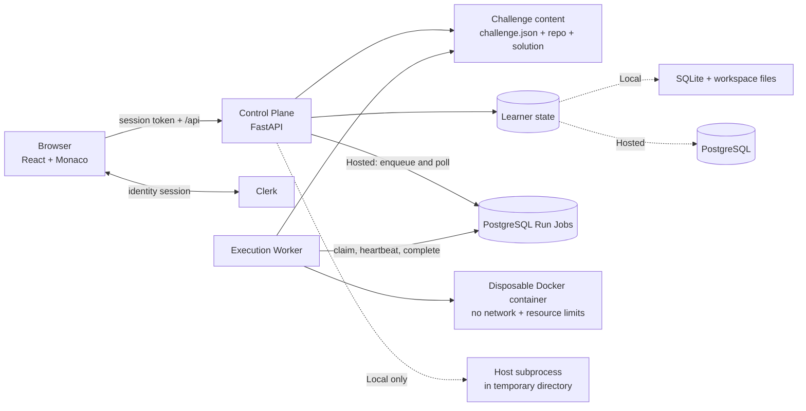
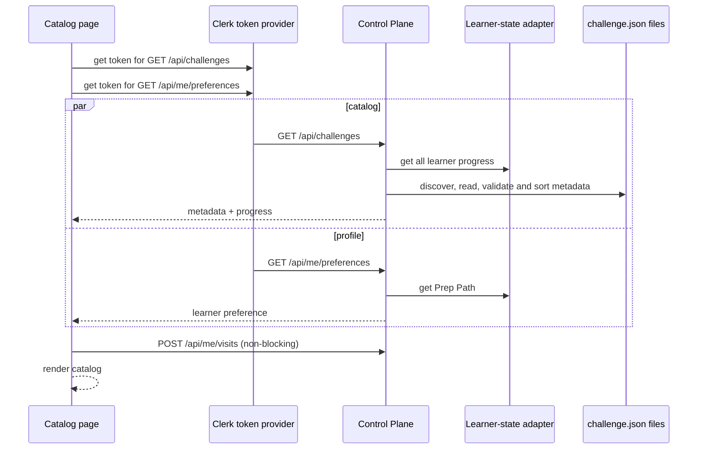
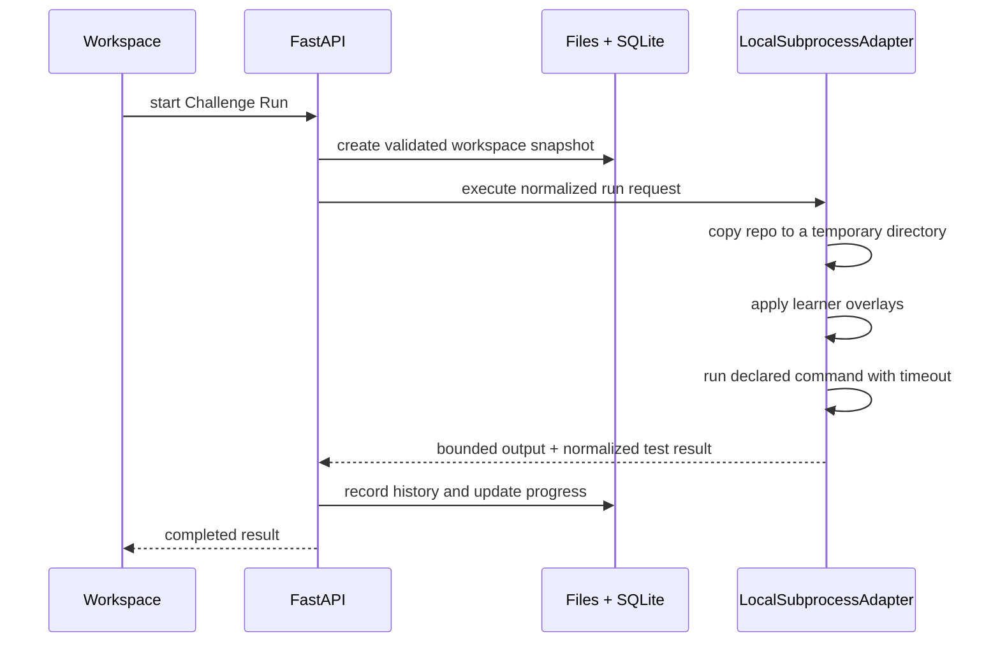
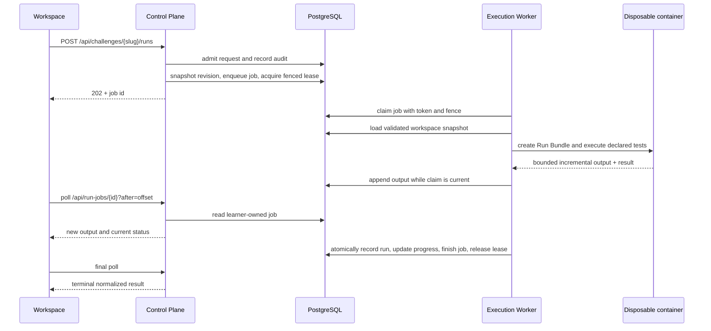

# MakeItGreen architecture

This document describes the product as it exists today, from opening the site
to running a challenge and promoting a release. It covers both supported
runtime modes and calls out the boundary between immutable challenge content
and learner-owned data.

## The short answer: where challenges live

Challenge definitions are **not rows in PostgreSQL**. Each challenge is a
versioned directory under [`challenges/`](challenges/):

```text
challenges/<slug>/
├── challenge.json   title, type, difficulty, timing, brief, runtime policy
├── repo/            broken starter repository and tests
├── solution/        reference write-up and changed files
└── variants/        optional additional language implementations
    └── <language>/
        ├── repo/
        └── solution/
```

These files ship with the application release and the execution worker. This
keeps the metadata, starter repository, tests, runtime declaration, and
solution in one reviewable Git revision. PostgreSQL stores the parts that vary
by learner: edits, progress, Challenge Run history, preferences, debriefs,
jobs, rate-limit state, and audit/product events.

A challenge stays one catalog concept when it has multiple languages. Its
default implementation keeps the historical state key (`orders-service`), and
additional implementations use `<slug>@<variant>`
(`orders-service@javascript`). This preserves existing Python progress while
isolating files, attempts, spoilers, runs, and debriefs for each language.

Putting the challenge definitions in PostgreSQL would not, by itself, fix the
current catalog delay. The catalog currently reads and validates 49 metadata
files totalling about 45 KB. A 100-run local measurement on 2026-09-04 put
[`load_all()`](backend/challenges.py) at approximately 1.06 ms median and 2.20
ms p95. The request has more expensive work around that read; see
[Why the catalog can feel slow](#why-the-catalog-can-feel-slow).

## The 60-second mental model



There are four main concerns:

1. The browser presents the catalog and coding workspace.
2. The Control Plane authenticates requests and owns product state changes.
3. Challenge content is immutable, release-versioned input.
4. Challenge execution is local and convenient in Local Mode, but isolated in
   a separate worker process and disposable container in Hosted Mode.

## What lives where

| Data or capability | Local Mode | Hosted Mode | Why |
|---|---|---|---|
| Challenge metadata, starter repos, tests, solutions | Files under `challenges/` | Files baked into the release images | Content and executable tests change together and are reviewed in Git |
| Browser application | Vite development server | Static build served by the Control Plane | One browser client for both modes |
| Identity | Optional Clerk session | Required verified Clerk session | Hosted state must have a tenant owner |
| Workspace edits | Files under `backend/data/workspaces/` | `workspace_files` in PostgreSQL | Local simplicity versus cross-device, cross-replica durability |
| Progress and Challenge Run history | Per-learner SQLite data | PostgreSQL | Same learner-state interface, different adapter |
| Prep Path and Learning Debrief | SQLite | PostgreSQL | Account-backed learning loop in Hosted Mode |
| Focus timer | Browser `localStorage` | Browser `localStorage` | Optional personal UI state; elapsed time is attached to a run only when used |
| Active Run Jobs | In-process memory | PostgreSQL | Hosted jobs must survive requests and coordinate replicas |
| Test execution | Host subprocess in a temporary directory | Separate worker plus a disposable Docker container | Untrusted code must not execute in the public API process |
| Rate limits and request audits | In-process/local adapter | PostgreSQL | Hosted admission must be durable and consistent across replicas |
| Security events | No-op by default | Structured JSON with pseudonymized learner subject | Safe operational collection without learner content |

## Source layout and ownership

```text
greenline/
├── frontend/
│   └── src/
│       ├── App.tsx             application shell
│       ├── api.ts              typed HTTP client
│       ├── auth.tsx            Clerk route and token bridge
│       ├── pages/
│       │   ├── Catalog.tsx     catalog, filtering, Prep Paths
│       │   ├── Workspace.tsx   brief, files, editor, runs, timer
│       │   └── Solution.tsx    solution and Learning Debrief
│       └── timer.ts            browser timer state machine
├── backend/
│   ├── app.py                  Control Plane routes and composition root
│   ├── auth.py                 Clerk request authentication
│   ├── challenges.py           challenge discovery and safe file policy
│   ├── learner_state.py        Local and PostgreSQL learner-state adapters
│   ├── progress.py             Local SQLite persistence
│   ├── run_jobs.py             Local in-memory asynchronous jobs
│   ├── run_coordination.py     durable queue, claims, fences, leases
│   ├── runner.py               local and container execution adapters
│   ├── abuse_controls.py       request admission, rate limits, audits
│   ├── operations.py           secrets, trusted proxies, security events
│   ├── serve.py                Hosted Control Plane launcher
│   ├── worker.py               Hosted Execution Worker launcher
│   └── migrations/             ordered PostgreSQL schema migrations
├── challenges/                 immutable product content
├── scripts/                    validation, image, release, and rollback tools
├── Dockerfile                  Hosted Control Plane image
└── Dockerfile.worker           Hosted Execution Worker image
```

The shared vocabulary and invariants live in [`CONTEXT.md`](CONTEXT.md).
Visual rules live in [`DESIGN.md`](DESIGN.md). Release operations live in
[`RELEASES.md`](RELEASES.md).

## Browser and API lifecycle

### 1. Application boot and identity

[`frontend/src/main.tsx`](frontend/src/main.tsx) creates the React router. The
landing page is public. Catalog, workspace, and solution routes pass through a
route gate. When Clerk is configured, the auth bridge makes Clerk's token
provider available to the HTTP client.

Every call in [`frontend/src/api.ts`](frontend/src/api.ts) asks the token
provider for a current token, adds it as a Bearer token when present, and then
uses the relative `/api` route. Vite proxies that route during local
development; the Hosted Control Plane serves both the compiled frontend and
the API from one image.

The backend authentication middleware verifies Clerk session tokens when
Clerk is configured and exposes the verified `sub` as the learner identity.
Hosted Mode refuses to start without a Clerk secret and a non-empty
authorized-party allowlist.

### 2. Catalog load



The catalog response contains metadata and progress, not every starter file or
solution. The current UI waits for both catalog and preference requests before
it renders the page. Prep Path membership is currently declared in
`Catalog.tsx`; the chosen path is persisted in learner preferences.

### 3. Opening a workspace

`GET /api/challenges/{slug}` loads one challenge's metadata, combines the
starter tree with the learner's overlay, and returns file names plus flags such
as `readonly`, `edited`, and `new`. File contents are fetched separately when a
learner opens a file.

This overlay model means the starter repository remains immutable:

```text
effective file = learner overlay, when one exists
                 otherwise challenge repo file
```

Create, update, delete, search, snapshot, and reset operations all pass through
the `LearnerStateAdapter`. The challenge policy prevents path traversal,
symlinks, changes to protected test/configuration files, and creation outside
declared prefixes.

The editor autosaves changes through the file API. Reset deletes the learner's
overlay, progress, run history, and debrief for that challenge; it does not
alter the versioned starter repository.

### 4. Focus timer

The timer is intentionally optional and user-controlled. Its running state is
kept in browser storage per challenge, so refreshing the page can restore it
without creating server traffic. When the learner runs tests, the elapsed time
is included as optional `session_elapsed_ms` and becomes part of that Challenge
Run record. The suggested number of minutes comes from `challenge.json`; it is
guidance, not an automatically started countdown.

## Challenge Run lifecycle

The browser uses one user experience in both modes, but composition selects a
different execution path.

### Local Mode



Local Mode is a trusted personal workflow. It may execute the tests as a host
subprocess, uses a process group for cleanup, and enforces a wall-clock timeout.
It must not be exposed to untrusted users.

### Hosted Mode



The public Control Plane has a disabled execution adapter and receives neither
the Docker CLI nor the Docker socket. The non-HTTP worker is the only process
with container authority. PostgreSQL is both the durable queue and the
coordination point.

Each queued job owns an Operation Lease for one learner/challenge pair. Worker
claims contain a unique claim token and a monotonically increasing fence. A
worker may publish output or completion only while both still match. If a
worker stalls and another recovers the job, the old worker cannot commit a late
result.

The disposable execution container receives one validated, read-only Run
Bundle and copies it into bounded ephemeral storage. The runtime policy uses:

- digest-pinned, preloaded Python or Node images;
- no network;
- a read-only root filesystem;
- non-root execution;
- dropped Linux capabilities and no privilege escalation;
- bounded memory, CPU, PIDs, temporary storage, output, and wall time.

The exact image contract is documented in
[`backend/execution-images/README.md`](backend/execution-images/README.md).

## Learning loop after execution

A Challenge Run stores its normalized counts, output tail, duration, optional
focus time, and per-test diagnostics. The learner's status moves through
`todo`, `attempted`, and `solved`; a successful result marks it solved.

Opening the solution marks the challenge as spoiled. A Learning Debrief can be
saved only after the challenge is solved and asks for root cause, why the fix
works, and a tradeoff, plus usefulness and optional feedback. The product also
records a bounded set of learning milestones such as first run, successful
run, debrief completion, and return visit. Product Events never contain source
code, debrief text, or the optional free-text comment.

## PostgreSQL model in Hosted Mode

Migrations are versioned under [`backend/migrations/`](backend/migrations/).
The application currently requires schema version 5.

| Table | Responsibility |
|---|---|
| `greenline_schema_version` | Enforces the exact migration version expected by the code |
| `learner_challenges` | One learner/challenge aggregate: progress, revision, spoil state, operation lease and fence |
| `workspace_files` | Learner-created or edited file overlays, scoped by learner and challenge |
| `challenge_runs` | Durable terminal run history and normalized results |
| `run_jobs` | Queued/running/terminal execution state, output, claim token, fence, and expiry |
| `request_rate_windows` | Cross-replica fixed-window request budgets |
| `request_audit_events` | Durable admitted-request lifecycle without bodies or file paths |
| `worker_releases` | Fresh worker readiness, source revision, and exact execution-image references |
| `learner_preferences` | Account-level Prep Path |
| `challenge_debriefs` | Post-solve Learning Debrief |
| `product_events` | Bounded beta learning-loop milestones with deduplication |

The database therefore holds **learner and operational state**, not the source
of truth for challenge content. A challenge slug is the stable join key between
release content and learner-owned rows.

## Runtime modes and fail-closed composition

`GREENLINE_MODE` is mandatory and accepts exactly `local` or `hosted`. The
application composition root selects all adapters at startup.

| Concern | Local Mode | Hosted Mode |
|---|---|---|
| Authentication | Optional | Required Clerk verification and authorized parties |
| Learner state | Filesystem + SQLite adapter | PostgreSQL adapter only |
| Job coordination | In-memory process store | PostgreSQL jobs, claims, capacity and leases |
| Execution | Local subprocess adapter | Disabled in API; container adapter in worker |
| Abuse controls | Local adapter | Durable PostgreSQL admission and auditing |
| Proxy trust | Local origins | Explicit trusted proxy CIDRs and supported launcher marker |
| Secrets | Development configuration | Exactly one direct value or absolute mounted-file source |
| Startup failure | Permissive for trusted use | Refuses traffic when a required safety dependency is absent |

There is no Hosted fallback to Local adapters. This is deliberate: a database,
auth, isolation, or configuration outage must not silently turn into unsafe
execution or tenant mixing.

## API surface

| Area | Routes | Purpose |
|---|---|---|
| Profile | `GET/PUT /api/me/preferences`, `GET /api/me/activity`, `POST /api/me/visits` | Prep Path, daily solve activity, and learning-loop visits |
| Catalog | `GET /api/challenges` | Challenge metadata joined with learner progress |
| Workspace | `GET /api/challenges/{slug}` and `/files/{path}` | Metadata, tree, and effective file content |
| Editing | `PUT/POST/DELETE .../files/{path}` | Save, create, or remove overlays under challenge policy |
| Tools | `GET .../search`, `POST .../reset` | Search the effective workspace or reset learner state |
| Runs | `POST .../run`, `POST .../runs`, `GET .../runs` | Local synchronous compatibility, async start, and history |
| Job output | `GET /api/run-jobs/{job_id}` | Poll bounded incremental output and terminal result |
| Solution | `POST .../spoil`, `GET .../solution` | Record reveal and read reference content |
| Debrief | `GET/PUT .../debrief` | Read or save the post-solve reflection |
| Operations | `/health/live`, `/health/ready`, `/health/release` | Process, dependency, and exact-version rollout health |

## Request admission, privacy, and trust boundaries

For Hosted API requests, middleware authenticates the learner and then performs
durable request admission before route mutation. It applies body-size limits,
per-learner request budgets, and active-run capacity. Failure of the admission
store fails closed. Security-relevant activity is emitted as structured JSON
with an HMAC-pseudonymized subject and a request ID.

The main trust boundaries are:

- the browser is untrusted input;
- Clerk assertions are trusted only after server-side verification;
- learner file overlays remain untrusted even after an earlier save;
- challenge content is trusted only because it belongs to the reviewed release;
- the Control Plane may mutate state but cannot execute learner code;
- the Execution Worker may execute Run Bundles but has no public listener or
  Clerk credentials;
- Docker authority is host-control authority and belongs only on a dedicated,
  preferably rootless worker daemon;
- forwarded headers are accepted only from explicitly configured trusted
  proxy networks.

## Health, deployment, and release flow

The product defines three different health contracts:

- `/health/live` says the Control Plane process is alive.
- `/health/ready` checks dependencies owned by that role. The Control Plane
  checks its PostgreSQL adapters and remains independently observable if
  execution capacity is unavailable.
- `/health/release` adds exact-version readiness. Fresh workers must report the
  same source commit and consistent digest-pinned execution images.

CI builds four artifacts: Control Plane, Execution Worker, Python execution,
and Node execution images. It scans the built filesystems, produces SBOM and
provenance evidence, runs deployment smoke tests, and publishes immutable
commit tags without rebuilding. Promotion moves an approved set of four image
digests together. Exact-version readiness gates the rollout; a failed or mixed
rollout automatically restores the complete prior digest set. See
[`RELEASES.md`](RELEASES.md) for the operator workflow.

PostgreSQL migrations run outside the application process before deployment.
The runtime database role should not have schema-changing privileges.

## Why the catalog can feel slow

The current catalog has several serial or page-blocking boundaries despite the
metadata read itself being small:

1. `Catalog.tsx` starts both `GET /api/challenges` and
   `GET /api/me/preferences`, then waits for **both** before rendering anything.
2. Each API call independently waits for the Clerk token provider before it can
   issue `fetch`.
3. The challenges request authenticates, queries all learner progress, then
   discovers and validates every `challenge.json` on every request.
4. The response currently has no release-keyed browser cache or ETag.
5. React `StrictMode` intentionally mounts effects twice in development. The
   first requests are aborted and then reissued, which can make local startup
   look worse than the production build.
6. A cold Vite/Clerk/browser startup can add module and session initialization
   time that is unrelated to challenge storage.

The filesystem scan is real work and should eventually be cached, but the
measurement above shows it is unlikely to explain a visibly long wait on its
own. The next performance work should be evidence-led:

1. Add browser timings and `Server-Timing` spans for token acquisition,
   authentication, learner-state query, challenge metadata, serialization,
   and total response time.
2. Add a combined catalog bootstrap endpoint returning metadata, progress, and
   the Prep Path in one authenticated round trip, or let the catalog render
   before the preference request completes.
3. Cache validated immutable metadata by release in Hosted Mode, with
   modification-time invalidation for Local Mode.
4. Add an ETag keyed by the release SHA and learner-state revision so unchanged
   payloads can avoid retransmission safely.

Moving challenge definitions into PostgreSQL becomes worthwhile only if the
product needs live authoring without a release, simultaneous published content
versions, or database-driven content queries. For the current reviewed,
repository-based product, keeping challenge content in Git and optimizing the
bootstrap path is the cleaner architecture.

## Core guarantees and known boundaries

The architecture is designed to guarantee:

- immutable starter and solution content per release;
- tenant-scoped learner state in Hosted Mode;
- no untrusted code execution in the public process;
- durable, capacity-bounded Hosted Run Jobs;
- fenced completion so superseded workers cannot commit;
- bounded output and resource use;
- fail-closed Hosted composition;
- exact-version, automatically reversible releases.

The deployment platform itself remains outside this repository. It must apply
the promoted digests, restart the appropriate services, provide PostgreSQL and
secret mounts, provision the dedicated worker container runtime, and export
logs/release evidence to the chosen operational systems.
