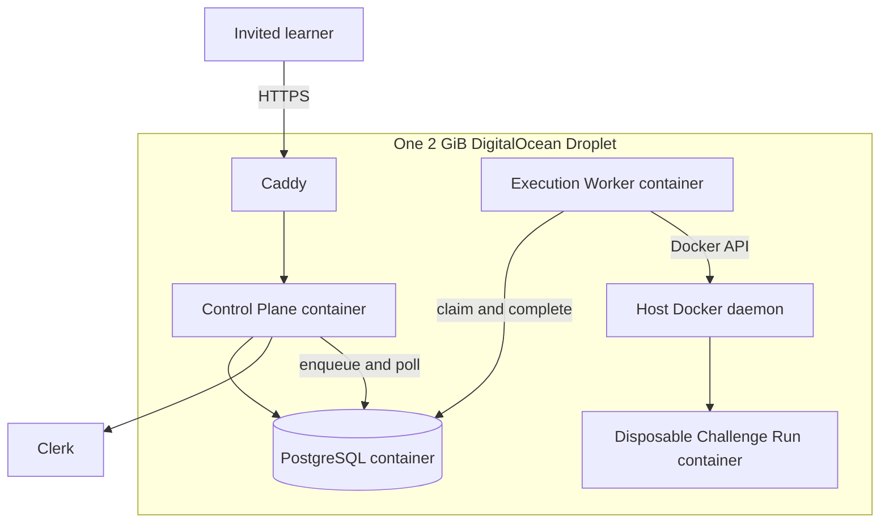

# Launching the MakeItGreen beta on DigitalOcean

This is the recommended low-cost deployment plan for an **invited beta**. It
keeps the product's Hosted Mode safety boundaries but colocates the services on
one virtual machine until usage justifies separate infrastructure.

This is a deployment runbook, not a claim that the server already exists. See
[Current repository readiness](#current-repository-readiness) for the pieces
that are ready and the pieces still missing.

The security decision record for this runbook is
[`THREAT_MODEL.md`](THREAT_MODEL.md). Do not open the beta until its G-1 through
G-10 launch gates have passing evidence and the owner has recorded both required
risk-acceptance decisions.

## Recommendation and expected cost

Start with one DigitalOcean Basic Droplet:

| Resource | Initial choice | Current price |
|---|---|---:|
| Droplet | 2 GiB RAM, 1 vCPU, 50 GiB SSD | $12/month |
| Weekly Droplet backup | Recommended for beta | $2.40/month |
| Cloud Firewall, VPC, and monitoring | Enabled | $0 |
| PostgreSQL | Self-hosted on the Droplet | Included |
| DNS | Existing registrar or a free DNS provider | Varies |
| Total infrastructure | Before domain/email costs | About $14.40/month |

DigitalOcean's current Basic Droplet table lists the 2 GiB configuration at
$12/month. Weekly backups for Basic plans add 20% of the Droplet price. Verify
the checkout total before creating anything because cloud pricing can change:

- [Droplet pricing](https://www.digitalocean.com/pricing/droplets)
- [Backup pricing](https://docs.digitalocean.com/products/backups/details/pricing/)

A single Challenge Run is limited by the application to 512 MiB. With worker
concurrency set to one, 2 GiB leaves room for the operating system, Control
Plane, worker, PostgreSQL, reverse proxy, and one execution container. This is
the minimum sensible beta size, not a promise for arbitrary traffic. Upgrade
to the 2-vCPU/$18 plan if Challenge Runs make the API feel CPU-starved, or the
4 GiB/$24 plan if memory alerts or swap activity appear.

## Deployment shape



Only Caddy exposes ports to the internet. PostgreSQL, the worker, and the
Docker API are private. The Control Plane does not receive Docker access. The
worker receives Docker access because that is its sole job.

This is weaker than putting the worker on a separate machine: control and
execution still share one host kernel. It is an explicit cost tradeoff for a
small, authenticated beta. Move the worker first when opening registration to
unknown users or increasing concurrency.

## Current repository readiness

### Already built

- A production Control Plane image in [`Dockerfile`](Dockerfile).
- A separate, non-HTTP worker image in
  [`Dockerfile.worker`](Dockerfile.worker).
- Digest-pinned Python and Node execution images.
- Hosted Mode that refuses unsafe or incomplete configuration.
- Clerk authentication and authorized-party checking.
- PostgreSQL learner state, Run Jobs, request admission, audits, and worker
  release heartbeats.
- Seven ordered PostgreSQL migrations.
- `/health/live`, `/health/ready`, and exact-version `/health/release` checks.
- CI tests, vulnerability scanning, SBOMs, provenance, immutable GHCR
  publication, protected promotion, and automatic rollback.

### Already configured externally

- `makeitgreen.dev` is registered in Cloudflare.
- The Clerk Production instance uses Invite-only access, a signed
  `beta_access` claim, and Google OAuth with custom production credentials.
- Clerk's `accounts.makeitgreen.dev`, `clerk.makeitgreen.dev`, and email DNS
  records were verified, and one invited user completed the hosted sign-in flow.

### Still needed before deployment

- Review, commit, and push the threat model and deployment reconciliation.
- Configure the GitHub `VITE_CLERK_PUBLISHABLE_KEY` repository variable.
- Create the DigitalOcean production Compose manifest and Caddyfile.
- Add and verify the final deployed application origin in Clerk, then confirm
  the frontend publishable key and backend secret belong to that same instance.
- Provision the Droplet, DNS record, firewall, secrets, and persistent data
  directories.
- Run migrations with a schema-owning database role and use a separate runtime
  role for the application.
- Configure PostgreSQL-aware backups and test restoration.
- Select a destination for security JSON logs and operational alerts.
- Bootstrap the initial four-image deployment. The promotion workflow expects
  an existing complete release to use as its rollback set.

## Step-by-step launch plan

### Phase 1: finish the release in GitHub

1. Review and commit the current worktree.
2. Push local `main` to the configured `origin` repository.
3. In GitHub repository settings, add the Actions variable
   `VITE_CLERK_PUBLISHABLE_KEY`. Use the publishable key for the Clerk instance
   that will serve the beta domain.
4. Confirm GitHub Actions can write Packages and attestations.
5. Push the release commit and wait for the **MakeItGreen** workflow to pass.
6. Download its `greenline-release-<commit>` manifest. It identifies the exact
   four image digests that were tested and published:

   ```text
   ghcr.io/<owner>/<repo>-control-plane@sha256:<digest>
   ghcr.io/<owner>/<repo>-execution-worker@sha256:<digest>
   ghcr.io/<owner>/<repo>-python-execution@sha256:<digest>
   ghcr.io/<owner>/<repo>-node-execution@sha256:<digest>
   ```

Do not deploy mutable `latest` tags. The API, worker, and execution images must
come from the same release manifest.

### Phase 2: configure the production identity

1. Create the production Clerk application or promote the intended Clerk
   configuration.
2. Keep Google as the configured sign-in provider, matching
   [`AUTH.md`](AUTH.md).
3. Set Clerk access mode to **Invite-only**, add the `beta_access` session
   claim from `public_metadata.beta_access`, and grant it only to approved testers.
4. Add the final application origin, for example
   `https://beta.example.com`, to the Clerk configuration.
5. Keep the Clerk secret key for the server. Never put it in the frontend or
   commit it.
6. Confirm the publishable key configured in GitHub belongs to this same Clerk
   application. It is compiled into the frontend image at build time.

Changing the publishable key requires a new image release; changing the secret
key requires only a server secret update and restart.

### Phase 3: create the DigitalOcean Droplet

In the DigitalOcean control panel:

1. Create a project for MakeItGreen.
2. Create an Ubuntu 24.04 LTS Basic Droplet.
3. Select 2 GiB RAM, 1 vCPU, and 50 GiB SSD.
4. Choose the region closest to the initial testers.
5. Authenticate with an SSH key; do not enable password login.
6. Enable VPC networking and monitoring.
7. Enable weekly backups.
8. Give the Droplet a stable name such as `makeitgreen-beta-1`.

DigitalOcean's current production-ready setup recommends SSH keys, a non-root
sudo user, VPC networking, monitoring, and backups:
[recommended Droplet setup](https://docs.digitalocean.com/products/droplets/getting-started/recommended-droplet-setup/).

### Phase 4: create the network boundary

Attach a DigitalOcean Cloud Firewall with these inbound rules:

| Protocol | Port | Source |
|---|---:|---|
| TCP | 22 | Your current administrator IP only |
| TCP | 80 | All IPv4 and IPv6 addresses |
| TCP | 443 | All IPv4 and IPv6 addresses |

Allow required outbound traffic so the application can reach Clerk, GHCR,
package/image registries during deployment, DNS, and time services. Do not add
inbound rules for PostgreSQL `5432`, FastAPI `8000`, or the Docker socket.

Cloud Firewalls are stateful and currently provided without an additional
charge: [DigitalOcean Cloud Firewalls](https://docs.digitalocean.com/products/networking/firewalls/).

### Phase 5: point the domain at the Droplet

1. Add an `A` record such as `beta.example.com` pointing to the Droplet's IPv4
   address.
2. Add an `AAAA` record only if IPv6 is configured and firewalled correctly.
3. Wait for the record to resolve publicly.
4. Do not start Caddy until the record points to the server; automatic
   certificate issuance needs the hostname to reach ports 80 and 443.

### Phase 6: secure the host and install Docker

1. SSH into the server as the initial account.
2. Create a named non-root sudo administrator if the Droplet setup did not
   already create one.
3. Apply Ubuntu security updates.
4. Install Docker Engine and the Docker Compose plugin from Docker's official
   apt repository.
5. Enable Docker at boot and verify `docker compose version`.
6. Install the DigitalOcean monitoring agent if it was not installed during
   provisioning.

Use Docker's maintained installation instructions rather than Ubuntu's older
convenience package:
[Install Docker Engine on Ubuntu](https://docs.docker.com/engine/install/ubuntu/).

Membership in the host `docker` group is effectively root authority. Restrict
server access and do not give application users shell accounts.

### Phase 7: create the deployment filesystem

Use a small, explicit hierarchy such as:

```text
/srv/makeitgreen/
├── compose.yaml
├── Caddyfile
├── release.env             image digest references only
├── secrets/                mode 0700; individual files mode 0600
│   ├── clerk_secret_key
│   ├── database_url
│   ├── postgres_password
│   └── security_log_hmac_key
├── postgres/               PostgreSQL data
├── caddy-data/             certificates and state
├── caddy-config/
├── run-bundles/            temporary Run Bundle handoff
└── backups/                encrypted/off-host export staging
```

The Run Bundle directory must be mounted at the exact same absolute path in
the worker and visible to the host Docker daemon. Bind-path resolution occurs
on the daemon host, not inside the worker container.

### Phase 8: configure production Compose

The Compose deployment should contain exactly four long-lived services:

1. `caddy`
2. `control-plane`
3. `execution-worker`
4. `postgres`

It must also pre-pull the two execution images used for disposable Challenge
Runs. Important settings:

- Only Caddy publishes host ports.
- Caddy reverse-proxies to `control-plane:8000` and obtains HTTPS
  automatically. See [Caddy's reverse-proxy quick start](https://caddyserver.com/docs/quick-starts/reverse-proxy).
- Use a fixed internal Compose subnet, for example `172.30.0.0/24`.
- Set `GREENLINE_TRUSTED_PROXY_CIDRS=172.30.0.0/24` so only the internal proxy
  network can supply forwarded headers.
- Mount Clerk, database, and security-log secrets as read-only files and use
  the application's `_FILE` environment variables.
- Keep PostgreSQL on the internal network with no published port.
- Give PostgreSQL a persistent data mount.
- Mount the Docker socket only into `execution-worker`, never into
  `control-plane`.
- Mount the host Run Bundle directory into the worker at the same absolute
  path.
- Use read-only roots, dropped capabilities, `no-new-privileges`, PID limits,
  and bounded `tmpfs` mounts where supported.
- Configure `restart: unless-stopped` and health checks.
- Set all three beta capacity values to one:

  ```text
  GREENLINE_WORKER_CONCURRENCY=1
  GREENLINE_MAX_ACTIVE_RUNS=1
  GREENLINE_MAX_ACTIVE_RUNS_PER_USER=1
  ```

The worker image runs as UID `65532`. The Compose service must receive only the
Docker socket's numeric group as a supplemental group. This socket still grants
host-level Docker authority, which is why it belongs only on the worker.

### Phase 9: configure secrets and environment

Create strong, independent values for:

- the PostgreSQL administrative password;
- the application database password;
- `GREENLINE_LOG_HMAC_KEY` with at least 32 random bytes;
- the Clerk secret key.

The Control Plane needs:

```text
CLERK_SECRET_KEY_FILE=/run/secrets/clerk_secret_key
CLERK_AUTHORIZED_PARTIES=https://beta.example.com
GREENLINE_DATABASE_URL_FILE=/run/secrets/database_url
GREENLINE_LOG_HMAC_KEY_FILE=/run/secrets/security_log_hmac_key
GREENLINE_TRUSTED_PROXY_CIDRS=172.30.0.0/24
GREENLINE_MAX_ACTIVE_RUNS=1
GREENLINE_MAX_ACTIVE_RUNS_PER_USER=1
GREENLINE_CONTENT_READS_PER_MINUTE=120
GREENLINE_DISTINCT_CHALLENGES_PER_HOUR=20
GREENLINE_SOLUTIONS_PER_HOUR=5
```

The worker needs:

```text
GREENLINE_DATABASE_URL_FILE=/run/secrets/database_url
GREENLINE_LOG_HMAC_KEY_FILE=/run/secrets/security_log_hmac_key
GREENLINE_PYTHON_EXECUTION_IMAGE=<exact digest reference>
GREENLINE_NODE_EXECUTION_IMAGE=<exact digest reference>
GREENLINE_RUN_BUNDLE_DIR=/srv/makeitgreen/run-bundles
GREENLINE_WORKER_CONCURRENCY=1
GREENLINE_MAX_ACTIVE_RUNS=1
GREENLINE_MAX_ACTIVE_RUNS_PER_USER=1
```

`GREENLINE_RELEASE_SHA` is baked into the official API and worker images. Do
not override it at runtime.

### Phase 10: authenticate to GHCR and pull the release

If the GitHub packages are private, create a narrowly scoped credential that
can read packages. Log the server into `ghcr.io`, then pull all four exact
digest references from the successful release manifest.

Verify locally that every configured reference contains `@sha256:`. Hosted
Mode deliberately rejects mutable execution-image tags and never pulls an
execution image while handling a learner request.

### Phase 11: initialize PostgreSQL and migrate

1. Start only PostgreSQL.
2. Wait until `pg_isready` succeeds.
3. Use a schema-owning administrative role to apply migrations `001` through
   `007` in numerical order with `ON_ERROR_STOP=1`.
4. Create a separate application role with connect, schema usage, table data,
   and sequence permissions—but no schema-changing privileges.
5. Put the application role's URL in `database_url`.
6. Validate that `greenline_schema_version` reports `7`.

The exact migration order is documented in
[`backend/migrations/README.md`](backend/migrations/README.md). Never let the
API automatically mutate its schema during startup.

### Phase 12: start and verify the application

Start the services in this order:

1. PostgreSQL
2. Execution images pre-pulled into the host daemon
3. Execution Worker
4. Control Plane
5. Caddy

Then verify:

```text
https://beta.example.com/health/live
https://beta.example.com/health/ready
https://beta.example.com/health/release
```

`/health/release` must return HTTP 200 and show:

- the expected full source commit;
- at least one live matching worker;
- the exact Python execution-image digest;
- the exact Node execution-image digest.

Finally, sign in as a beta learner, edit a file, refresh the page, run one
Python challenge and one Node challenge, inspect run history, and reset a
challenge. That verifies identity, persistence, both execution runtimes, output
polling, and cleanup—not just the landing page.

### Phase 13: configure backups and alerts

Droplet snapshots alone are not a sufficient database recovery plan because
they are crash-consistent system images and may affect disk performance during
capture. Use both:

1. weekly Droplet backups for whole-server recovery; and
2. a scheduled PostgreSQL logical dump encrypted and copied off the Droplet.

Test a restore into a disposable database before inviting users. Alert on:

- host memory above 80%;
- disk above 75%;
- repeated container OOM kills;
- `/health/ready` or `/health/release` failures;
- no fresh worker heartbeat;
- growing queued Run Jobs;
- repeated security events or rate-limit exhaustion.

### Phase 14: open the invited beta

1. Keep Clerk in Invite-only mode and grant `beta_access: true` only to the
   short list of approved testers.
2. Keep worker concurrency at one.
3. Set a DigitalOcean billing alert.
4. Observe queue time, execution duration, container failures, memory, and
   PostgreSQL size for at least one week.
5. Upgrade vertically before increasing worker concurrency: choose the
   2-vCPU/$18 plan for CPU contention or the 4-GiB/$24 plan for memory pressure.
6. Move the worker to its own Droplet before opening anonymous registration.

## Why not Railway?

Railway is a good fit for most of MakeItGreen:

- it can deploy the Control Plane from a Dockerfile or image;
- it provides private service networking;
- it can run an ordinary background worker;
- it can provision PostgreSQL and persistent volumes.

The mismatch is the current Execution Worker. It does not merely process data;
it controls a Docker daemon to create a new disposable, network-disabled,
resource-limited container for every Challenge Run. Railway documents that its
service containers are non-privileged and that Docker-in-Docker workflows that
build and mount containers fail:
[Railway's non-privileged-container limitation](https://docs.railway.com/guides/github-actions-runners).

Railway also translates Compose into isolated services rather than running a
Compose file directly. Its volumes attach to one service and do not expose a
host Docker socket:
[deploying Compose applications on Railway](https://docs.railway.com/guides/docker-compose).

So the current worker cannot run unchanged on a standard Railway service. The
possible alternatives are:

1. **Hybrid deployment:** Railway hosts the Control Plane and PostgreSQL while
   a separate VPS hosts the worker. This adds cross-provider networking,
   credentials, cost, and failure modes without helping the small beta.
2. **Rewrite the execution adapter:** use an external sandbox API or Railway's
   emerging VM/sandbox primitive instead of Docker. Railway currently lists
   those VMs as beta/Priority Boarding and prices them separately at much
   higher per-resource rates, so this is not the cheap, stable launch path:
   [Railway pricing and VM beta](https://docs.railway.com/pricing/plans).
3. **Remove isolation:** execute learner code inside the normal worker
   container. This would expose application credentials and tenant data and is
   not acceptable for a public product.

Railway's normal compute is usage-priced—currently $10 per GiB-month of RAM and
$20 per vCPU-month, with a $5 Hobby minimum—so an always-on API, database, and
worker is not automatically cheaper than a fixed $12 Droplet:
[Railway pricing](https://docs.railway.com/pricing).

The conclusion is therefore narrower than “Railway cannot host MakeItGreen.”
Railway can host the web and data components, but it cannot host the **current
Docker-based execution boundary** as a standard service. DigitalOcean is the
cheapest straightforward place to run the system without rewriting that
boundary.

## Upgrade path

The single-Droplet beta does not trap the product in this topology:

1. Resize to 2 vCPUs when execution competes with the API, or to 4 GiB when
   memory becomes the constraint.
2. Move the Execution Worker and its dedicated/rootless Docker daemon to a
   private second Droplet when trust or concurrency becomes the constraint.
3. Move PostgreSQL to a managed service when database operations and recovery
   become the constraint.
4. Add multiple workers only after the queue and fenced-lease metrics show the
   need.
5. Consider a sandbox provider or VM-per-run adapter only when its operational
   savings justify an execution-layer change.

The adapter boundaries already implemented in the application make each step
an infrastructure migration rather than a product rewrite.
