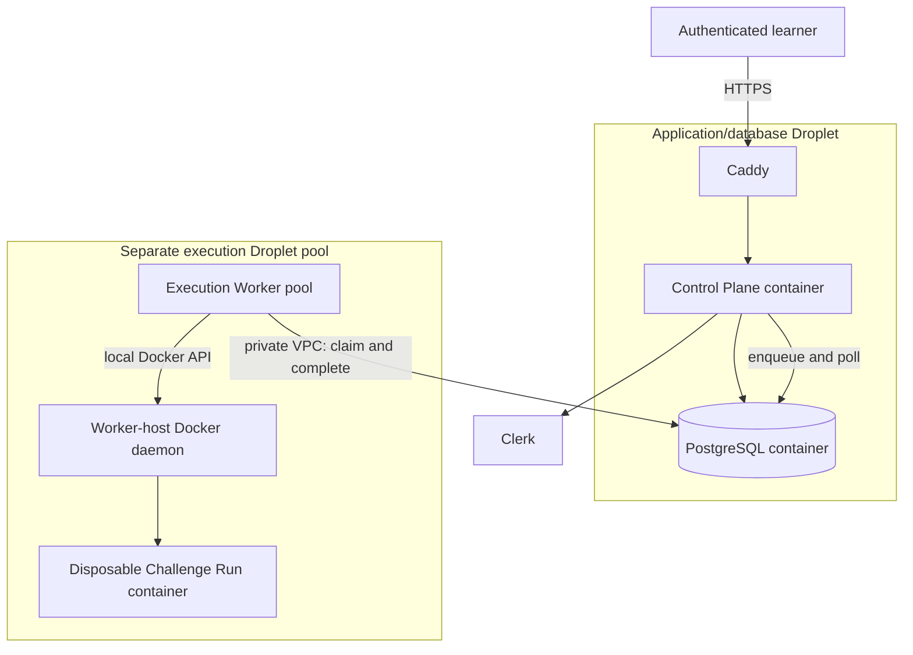

# Operating MakeItGreen on DigitalOcean

This is the recommended low-cost deployment plan for authenticated self-service
access. It keeps untrusted Challenge Runs on execution hosts that are separate
from the public Control Plane and PostgreSQL.

This is a deployment runbook, not a claim that the server already exists. See
[Current repository readiness](#current-repository-readiness) for the pieces
that are ready and the pieces still missing.

The database hosting decision has two explicit stages:

1. The initial deployment uses self-hosted PostgreSQL on the application Droplet so
   both trust zones remain inside one DigitalOcean VPC while capacity and the
   learning loop are still being proven.
2. Before the broader public launch, rehearse and perform the controlled Neon
   cutover in [`MIGRATE_NEON.md`](MIGRATE_NEON.md). The application and worker
   remain provider-neutral; only their database secret files change.

Do not combine the database move with the first public launch. Complete the
cutover, observe the Neon-backed deployment, and approve it before opening the
larger cohort.

The security decision record for this runbook is
[`THREAT_MODEL.md`](THREAT_MODEL.md). Do not open the beta until its G-1 through
G-10 launch gates have passing evidence and the owner has recorded final launch
approval.

## Recommendation and expected cost

Provision two 1 GiB Basic Droplets for staging, then resize or add execution
workers until the capacity probe passes. The staging floor is:

| Resource | Initial choice | Current price |
|---|---|---:|
| Application/database Droplet | 1 GiB RAM, 1 vCPU, 25 GiB SSD | $6/month |
| Weekly application Droplet backup | Recommended for beta | $1.20/month |
| Execution Worker Droplet | 1 GiB RAM, 1 vCPU, 25 GiB SSD | $6/month |
| Cloud Firewall, VPC, and monitoring | Enabled | $0 |
| PostgreSQL | Self-hosted on the application Droplet | Included |
| DNS | Existing registrar or a free DNS provider | Varies |
| Staging floor | Before domain/email costs | About $13.20/month |

DigitalOcean's current Basic Droplet table lists the 1 GiB configuration at
$6/month. Weekly backups for Basic plans add 20% of the protected Droplet's
price. The stateless worker does not need a Droplet backup. Verify
the checkout total before creating anything because cloud pricing can change:

- [Droplet pricing](https://www.digitalocean.com/pricing/droplets)
- [Backup pricing](https://docs.digitalocean.com/products/backups/details/pricing/)

The 1 GiB worker is a staging baseline, not promised beta capacity. Set
`GREENLINE_RUN_MEMORY_MIB=384` initially and use concurrency one only while
proving isolation. Before inviting learners, run
[`scripts/execution_capacity_probe.py`](scripts/execution_capacity_probe.py)
with the named workload scenarios below. Resize the worker or add worker
Droplets until every scenario meets its queue-start SLO. Keep at least 512 MiB
outside the configured container limits for the worker host, Docker daemon, and
operating system, and use the measured CPU and memory peaks rather than nominal
RAM alone when choosing the pool.

### What 15, 50, and 100 learners mean

An **active learner** is someone editing during the scenario window; it does not
mean that every learner has a container executing at the same instant. Each
synthetic learner submits one run. **Worker concurrency** is the separate number
of Challenge Run containers that can execute at once across the pool.

| Scenario | Defined workload | p95 queue start | Maximum queue start |
|---|---|---:|---:|
| `small-burst` | 15 learners each submit once within 10 seconds | ≤ 30 seconds | ≤ 60 seconds |
| `cohort-50` | 50 active learners each submit once during a five-minute cycle | ≤ 10 seconds | ≤ 30 seconds |
| `cohort-100` | 100 active learners each submit once during a five-minute cycle | ≤ 10 seconds | ≤ 30 seconds |
| `peak-burst-100` | 100 learners each submit once within 10 seconds | ≤ 30 seconds | ≤ 60 seconds |
| `retry-burst` | 25 learners each retry once within 10 seconds | ≤ 30 seconds | ≤ 60 seconds |

The default challenge mix rotates a short Python repository challenge, a Node
challenge, and a more computational Python challenge. A red test result still
counts as a successfully completed execution; failures here mean rejected,
lost, timed-out, or infrastructure-failed Run Jobs. These definitions are the
beta planning assumptions. Replace them only when observed product telemetry
supports a different run frequency.

For an initial worker estimate, use the normal-cohort measurements:

```text
slots ≈ ceiling(runs per second × p95 execution seconds × 1.25 headroom)
```

Then enforce the memory ceiling per host and run the probe; the formula is only
a starting point. Bursts may queue within their 30-second SLO, so they do not
require one execution slot per learner. A configuration passes only when the
probe has zero admission rejections, zero lost/infrastructure-failed jobs, every
job reaches a terminal state, the queue SLO passes, and host monitoring shows no
OOM or swap pressure.

The JSON separates terminal job failures (`failed`) from completed jobs with
unusable execution results (`execution_failures`). Only exit codes 0 and 1
count as finished test runs; timeouts, killed containers, runner errors, and
missing results fail the gate. `arrival_window_seconds` and
`arrivals_per_minute` describe the requested workload;
`actual_arrival_window_seconds` measures through the final enqueue response.
`arrival_window_met` must be true, so slow submissions cannot silently turn a
burst into a lighter workload. Completion polling is excluded from this window.

## Deployment shape



Only Caddy exposes application ports to the internet. PostgreSQL listens on the
application host's private VPC interface and accepts port 5432 only from tagged
execution workers. Worker hosts expose no HTTP service. The Docker socket and
Run Bundle directory exist only on each worker host, so a container or daemon
compromise does not directly expose the Control Plane host or Clerk secret.

## Current repository readiness

### Already built

- A production Control Plane image in [`Dockerfile`](Dockerfile).
- A separate, non-HTTP worker image in
  [`Dockerfile.worker`](Dockerfile.worker).
- Digest-pinned Python and Node execution images.
- Hosted Mode that refuses unsafe or incomplete configuration.
- Clerk authentication and authorized-party checking.
- PostgreSQL learner state, Run Jobs, request admission, audits, and worker
  release heartbeats.
- Seven ordered PostgreSQL migrations.
- `/health/live`, `/health/ready`, and exact-version `/health/release` checks.
- CI tests, vulnerability scanning, SBOMs, provenance, immutable GHCR
  publication, protected promotion, and automatic rollback.
- Separate application and worker Compose manifests, a hardened Caddy edge,
  PostgreSQL TLS policy, environment templates, and a fail-closed deployment
  validator under [`deploy/`](deploy/).

### Already configured externally

- `makeitgreen.dev` is registered in Cloudflare.
- The Clerk Production instance uses Open access and Google OAuth with custom
  production credentials. Every application API remains authenticated.
- Clerk's `accounts.makeitgreen.dev`, `clerk.makeitgreen.dev`, and email DNS
  records were verified, and one invited user completed the hosted sign-in flow.

### Still needed before deployment

- Review, commit, and push the deployment bundle.
- Copy each host's files from [`deploy/`](deploy/), install its secrets, and run
  [`scripts/validate_deployment.py`](scripts/validate_deployment.py).
- Add and verify the final deployed application origin in Clerk, then confirm
  the frontend publishable key and backend secret belong to that same instance.
- Provision both Droplets in one VPC, the DNS record, separate firewalls,
  secrets, and persistent data directories.
- Run migrations with a schema-owning database role and use a separate runtime
  role for the application.
- Configure PostgreSQL-aware backups and test restoration.
- Select a destination for security JSON logs and operational alerts.
- Bootstrap the initial four-image deployment. The promotion workflow expects
  an existing complete release to use as its rollback set.

## Step-by-step launch plan

### Phase 1: finish the release in GitHub

1. Review and commit the current worktree.
2. Push local `main` to the configured `origin` repository.
3. In GitHub repository settings, add the Actions variable
   `VITE_CLERK_PUBLISHABLE_KEY`. Use the publishable key for the Clerk instance
   that will serve the beta domain.
4. Confirm GitHub Actions can write Packages and attestations.
5. Push the release commit and wait for the **MakeItGreen** workflow to pass.
6. Download its `greenline-release-<commit>` manifest. It identifies the exact
   four image digests that were tested and published:

   ```text
   ghcr.io/<owner>/<repo>-control-plane@sha256:<digest>
   ghcr.io/<owner>/<repo>-execution-worker@sha256:<digest>
   ghcr.io/<owner>/<repo>-python-execution@sha256:<digest>
   ghcr.io/<owner>/<repo>-node-execution@sha256:<digest>
   ```

Do not deploy mutable `latest` tags. The API, worker, and execution images must
come from the same release manifest.

### Phase 2: configure the production identity

1. Create the production Clerk application or promote the intended Clerk
   configuration.
2. Keep Google as the configured sign-in provider, matching
   [`AUTH.md`](AUTH.md).
3. Set Clerk access mode to **Open**. Do not configure or depend on a
   `beta_access` custom claim; any user with a valid Clerk session may use the
   authenticated application.
4. Add the final application origin, `https://makeitgreen.dev`, to the Clerk
   configuration.
5. Keep the Clerk secret key for the server. Never put it in the frontend or
   commit it.
6. From **API keys → Show JWT public key**, copy the PEM Public Key into the
   server's `clerk_jwt_key` secret file. This lets the API verify tokens locally.
7. Confirm the publishable key configured in GitHub belongs to this same Clerk
   application. It is compiled into the frontend image at build time.

Changing the publishable key requires a new image release; changing the secret
key requires only a server secret update and restart.

### Phase 3: create the DigitalOcean Droplets

In the DigitalOcean control panel:

1. Create a project for MakeItGreen.
2. Choose the region closest to the initial testers and create one VPC there.
3. Create an Ubuntu 24.04 LTS Basic application/database Droplet with 1 GiB
   RAM, 1 vCPU, and 25 GiB SSD.
4. Create a separate Ubuntu 24.04 LTS Basic execution Droplet with the same
   initial size. This is the minimum staging size and may need resizing before
   beta.
5. Attach both Droplets to the same VPC.
6. Authenticate with SSH keys; do not enable password login.
7. Enable monitoring on both Droplets and weekly backups only on the stateful
   application/database Droplet.
8. Give them stable names such as `makeitgreen-app-1` and
   `makeitgreen-worker-1`. Give every future worker a common `execution-worker`
   tag so firewall rules can address the pool.

DigitalOcean's current production-ready setup recommends SSH keys, a non-root
sudo user, VPC networking, monitoring, and backups:
[recommended Droplet setup](https://docs.digitalocean.com/products/droplets/getting-started/recommended-droplet-setup/).

### Phase 4: create the network boundary

Attach an application Cloud Firewall with these inbound rules:

| Protocol | Port | Source |
|---|---:|---|
| TCP | 22 | Your current administrator IP only |
| TCP | 80 | All IPv4 and IPv6 addresses |
| TCP | 443 | All IPv4 and IPv6 addresses |
| TCP | 5432 | Droplets tagged `execution-worker` over the VPC only |

Bind PostgreSQL only to the application Droplet's private VPC address; never
publish it on `0.0.0.0`. Require TLS for the cross-host database connection.
FastAPI port 8000 remains private to the application Compose network.

Attach a worker Cloud Firewall that permits SSH only from the current
administrator IP and has no public application ingress. Allow worker egress to
PostgreSQL on the application Droplet's private VPC address, HTTPS for immutable
image deployment, DNS, and time services. Challenge Run containers still use
`--network none`, regardless of the worker host's egress policy. Never expose a
Docker TCP socket.

Cloud Firewalls are stateful and currently provided without an additional
charge: [DigitalOcean Cloud Firewalls](https://docs.digitalocean.com/products/networking/firewalls/).

### Phase 5: point the domain at the application Droplet

1. Add an `A` record for `makeitgreen.dev` pointing to the application
   Droplet's public IPv4 address.
2. Add an `AAAA` record only if IPv6 is configured and firewalled correctly.
3. Wait for the record to resolve publicly.
4. Do not start Caddy until the record points to the server; automatic
   certificate issuance needs the hostname to reach ports 80 and 443.

### Phase 6: secure both hosts and install Docker

1. SSH into each server as the initial account.
2. Create a named non-root sudo administrator if the Droplet setup did not
   already create one.
3. Apply Ubuntu security updates.
4. Install Docker Engine and the Docker Compose plugin from Docker's official
   apt repository.
5. Enable Docker at boot and verify `docker compose version`.
6. Install the DigitalOcean monitoring agent on both hosts if it was not
   installed during provisioning.

Use Docker's maintained installation instructions rather than Ubuntu's older
convenience package:
[Install Docker Engine on Ubuntu](https://docs.docker.com/engine/install/ubuntu/).

Membership in the host `docker` group is effectively root authority. Restrict
server access and do not give application users shell accounts.

### Phase 7: create the deployment filesystem

Use separate, explicit hierarchies. On the application/database host:

```text
/srv/makeitgreen/
├── compose.app.yaml
├── Caddyfile
├── release.env             image digest references only
├── secrets/                mode 0700; individual files mode 0600
│   ├── clerk_secret_key
│   ├── clerk_jwt_key
│   ├── api_database_url
│   ├── postgres_password
│   └── security_log_hmac_key
├── postgres/               PostgreSQL data
├── caddy-data/             certificates and state
├── caddy-config/
└── backups/                encrypted/off-host export staging
```

On every execution host:

```text
/srv/makeitgreen/
├── compose.worker.yaml
├── release.env             worker and execution-image digests only
├── secrets/                mode 0700; individual files mode 0600
│   ├── worker_database_url
│   └── security_log_hmac_key
└── run-bundles/            local temporary Run Bundle handoff
```

The Run Bundle directory is local to each execution host. Mount it into that
host's worker at the exact same absolute path visible to that host's Docker
daemon. The Control Plane never mounts or shares this directory.

### Phase 8: configure production Compose

Use the checked-in [`deploy/app/compose.app.yaml`](deploy/app/compose.app.yaml),
[`deploy/worker/compose.worker.yaml`](deploy/worker/compose.worker.yaml), and
[`deploy/app/Caddyfile`](deploy/app/Caddyfile). The exact copy, secret, validation,
and startup sequence is in [`deploy/README.md`](deploy/README.md). Do not merge
the two manifests onto one host.

The application Compose deployment contains exactly three long-lived services:

1. `caddy`
2. `control-plane`
3. `postgres`

Each worker Compose deployment contains only `execution-worker`; disposable
Challenge Run containers are created through the host Docker daemon. Important
settings:

- Only Caddy publishes host ports.
- Caddy reverse-proxies to `control-plane:8000` and obtains HTTPS
  automatically. See [Caddy's reverse-proxy quick start](https://caddyserver.com/docs/quick-starts/reverse-proxy).
- Use a fixed internal Compose subnet, for example `172.30.0.0/24`.
- Set `GREENLINE_TRUSTED_PROXY_CIDRS=172.30.0.0/24` so only the internal proxy
  network can supply forwarded headers.
- Mount Clerk, database, and security-log secrets as read-only files and use
  the application's `_FILE` environment variables.
- Publish PostgreSQL only on the application host's private VPC address and
  protect it with PostgreSQL TLS plus the Cloud Firewall worker-tag rule.
- Give PostgreSQL a persistent data mount.
- Mount the Docker socket only into `execution-worker` on execution hosts. The
  application host must not expose or mount Docker authority into the Control
  Plane.
- Mount the host Run Bundle directory into the worker at the same absolute
  path.
- Use read-only roots, dropped capabilities, `no-new-privileges`, PID limits,
  and bounded `tmpfs` mounts where supported.
- Configure `restart: unless-stopped` and health checks on both deployments.
- Configure one active run per learner, then derive the global queue bound and
  each host's concurrency from the capacity probe:

  ```text
  GREENLINE_MAX_ACTIVE_RUNS_PER_USER=1
  GREENLINE_MAX_ACTIVE_RUNS=<bounded queue capacity>
  GREENLINE_WORKER_CONCURRENCY=<measured safe slots on this host>
  GREENLINE_RUN_MEMORY_MIB=384
  ```

  `GREENLINE_MAX_ACTIVE_RUNS` must match on the Control Plane and every worker.
  `GREENLINE_WORKER_CONCURRENCY` is per execution host. Start it at one only for
  staging isolation checks; do not use that value for beta unless the capacity
  evidence passes.

The worker image runs as UID `65532`. Each worker service must receive only the
Docker socket's numeric group as a supplemental group. This socket still grants
host-level Docker authority, which is why it belongs only on the worker.

### Phase 9: configure secrets and environment

Create strong, independent values for:

- the PostgreSQL administrative password;
- separate Control Plane and worker database passwords;
- `GREENLINE_LOG_HMAC_KEY` with at least 32 random bytes;
- the Clerk secret key.
- the Clerk PEM JWT public key.

The Control Plane needs:

```text
CLERK_SECRET_KEY_FILE=/run/secrets/clerk_secret_key
CLERK_JWT_KEY_FILE=/run/secrets/clerk_jwt_key
CLERK_AUTHORIZED_PARTIES=https://makeitgreen.dev
GREENLINE_DATABASE_URL_FILE=/run/secrets/api_database_url
GREENLINE_LOG_HMAC_KEY_FILE=/run/secrets/security_log_hmac_key
GREENLINE_TRUSTED_PROXY_CIDRS=172.30.0.0/24
GREENLINE_MAX_ACTIVE_RUNS=<bounded queue capacity from the probe>
GREENLINE_MAX_ACTIVE_RUNS_PER_USER=1
GREENLINE_CONTENT_READS_PER_MINUTE=120
GREENLINE_DISTINCT_CHALLENGES_PER_HOUR=20
GREENLINE_SOLUTIONS_PER_HOUR=5
```

The worker needs:

```text
GREENLINE_DATABASE_URL_FILE=/run/secrets/worker_database_url
GREENLINE_LOG_HMAC_KEY_FILE=/run/secrets/security_log_hmac_key
GREENLINE_PYTHON_EXECUTION_IMAGE=<exact digest reference>
GREENLINE_NODE_EXECUTION_IMAGE=<exact digest reference>
GREENLINE_RUN_BUNDLE_DIR=/srv/makeitgreen/run-bundles
GREENLINE_RUN_MEMORY_MIB=384
GREENLINE_WORKER_CONCURRENCY=<measured safe slots on this host>
GREENLINE_MAX_ACTIVE_RUNS=<same bounded queue capacity as the Control Plane>
GREENLINE_MAX_ACTIVE_RUNS_PER_USER=1
```

The worker database URL uses the application Droplet's private VPC hostname or
address with certificate verification enabled. The worker role needs only the
learner-state and Run Job reads/writes required to claim and complete work; it
must not receive Clerk credentials, schema ownership, or administrative
PostgreSQL privileges.

For beta, both runtime URLs target the private-VPC PostgreSQL service. Preserve
this boundary from the first deployment:

- runtime URLs live only in `api_database_url` and `worker_database_url`;
- the schema-owner URL is used interactively for migrations and is never
  mounted into either runtime container;
- no image, Compose manifest, or application setting contains a database host;
- PostgreSQL's major version is recorded with each restore drill so the future
  Neon project can be created on the same version.

After the Neon cutover, the two runtime secret files contain Neon **pooled**
TLS URLs. Dumps, restores, schema migrations, and administrative validation use
a separate Neon **direct** URL. Never put that direct administrative URL into a
long-lived application or worker secret.

`GREENLINE_RELEASE_SHA` is baked into the official API and worker images. Do
not override it at runtime.

### Phase 10: authenticate to GHCR and pull the release

If the GitHub packages are private, create narrowly scoped credentials that can
read packages. Pull only the Control Plane image on the application host. Pull
the worker plus both execution images on every execution host. All four exact
digest references still come from one successful release manifest.

Verify locally that every configured reference contains `@sha256:`. Hosted
Mode deliberately rejects mutable execution-image tags and never pulls an
execution image while handling a learner request.

### Phase 11: initialize PostgreSQL and migrate

1. Start only PostgreSQL.
2. Wait until `pg_isready` succeeds.
3. Use a schema-owning administrative role to apply migrations `001` through
   `007` in numerical order with `ON_ERROR_STOP=1`.
4. Create separate Control Plane and execution-worker roles with connect,
   schema usage, only their required table/sequence permissions, and no
   schema-changing privileges.
5. Put the corresponding role URL in each host's secret file.
6. Validate that `greenline_schema_version` reports `7`.

The exact migration order is documented in
[`backend/migrations/README.md`](backend/migrations/README.md). Never let the
API automatically mutate its schema during startup.

### Phase 12: start and verify the application

Start the services in this order:

1. PostgreSQL on the application host
2. Execution images pre-pulled into every worker-host daemon
3. The complete Execution Worker pool
4. Control Plane
5. Caddy

Then verify:

```text
https://makeitgreen.dev/health/live
https://makeitgreen.dev/health/ready
https://makeitgreen.dev/health/release
```

`/health/release` must return HTTP 200 and show:

- the expected full source commit;
- the expected count of live matching workers;
- the exact Python execution-image digest;
- the exact Node execution-image digest.

Verify from outside the VPC that PostgreSQL 5432, FastAPI 8000, every worker,
and the Docker API are unreachable. Verify from a worker host that its
certificate-verified PostgreSQL connection succeeds over the private VPC.

Finally, sign in as a beta learner, edit a file, refresh the page, run one
Python challenge and one Node challenge, inspect run history, and reset a
challenge. That verifies identity, persistence, both execution runtimes, output
polling, and cleanup—not just the landing page.

### Phase 13: configure backups and alerts

Droplet snapshots alone are not a sufficient database recovery plan because
they are crash-consistent system images and may affect disk performance during
capture. Use both:

1. weekly application-Droplet backups for whole-server recovery; and
2. a scheduled PostgreSQL logical dump encrypted and copied off that Droplet.

Test a restore into a disposable database before inviting users. Alert on:

- host memory above 80%;
- disk above 75%;
- repeated container OOM kills;
- `/health/ready` or `/health/release` failures;
- no fresh worker heartbeat;
- growing queued Run Jobs;
- repeated security events or rate-limit exhaustion.

Set separate memory alerts on the application host and every execution host so
an unhealthy worker cannot hide behind healthy aggregate utilization.

Keep the logical dumps in custom format with ownership and ACLs excluded, and
record the PostgreSQL client/server versions beside each artifact. At least one
restore drill must also exercise the source-to-Neon rehearsal described in
[`MIGRATE_NEON.md`](MIGRATE_NEON.md) before the public-launch cutover.

### Phase 14: open authenticated self-service access

1. Set Clerk access mode to **Open** and confirm that a newly created account
   can load `/challenges`. Authentication remains required for every API
   request; only the separate enrollment gate is removed.
2. On the disposable staging database connected to the real worker pool, run:

   ```bash
   GREENLINE_CAPACITY_PROBE_ACK=disposable-staging \
   GREENLINE_TEST_DATABASE_URL_FILE=/run/secrets/capacity_probe_database_url \
   python scripts/execution_capacity_probe.py \
     --scenarios small-burst cohort-50 cohort-100 peak-burst-100 retry-burst \
     --slugs config-merge webhook-batch-node report-latency \
     --worker-count <number-of-worker-droplets> \
     --worker-concurrency <slots-per-worker> \
     --run-memory-mib 384 \
     --global-active-limit <configured-global-limit> \
     --output capacity-evidence.json
   ```

   The probe creates synthetic learner and run records, bypasses Clerk and the
   public API, and therefore must never target production. It exercises the
   actual PostgreSQL queue, worker pool, execution images, and Docker limits.
3. Resize workers or add identically configured worker Droplets until every
   named scenario admits and completes every run, normal cohorts meet their
   ten-second p95/30-second maximum queue-start SLO, and bursts meet their
   30-second p95/60-second maximum SLO. Then repeat one small end-to-end test
   through the public API to cover Clerk and edge overhead.
4. Keep `GREENLINE_MAX_ACTIVE_RUNS_PER_USER=1`. Set the global active limit high
   enough for the measured worker slots plus a short bounded burst queue; it is
   not a global concurrency setting and must not be set to one.
5. Set a DigitalOcean billing alert.
6. Observe queue wait, execution duration, container failures, per-host memory,
   worker count, and PostgreSQL size for at least one week. Add workers before
   a named scenario's queue-start SLO is exceeded.

## Why not Railway?

Railway is a good fit for most of MakeItGreen:

- it can deploy the Control Plane from a Dockerfile or image;
- it provides private service networking;
- it can run an ordinary background worker;
- it can provision PostgreSQL and persistent volumes.

The mismatch is the current Execution Worker. It does not merely process data;
it controls a Docker daemon to create a new disposable, network-disabled,
resource-limited container for every Challenge Run. Railway documents that its
service containers are non-privileged and that Docker-in-Docker workflows that
build and mount containers fail:
[Railway's non-privileged-container limitation](https://docs.railway.com/guides/github-actions-runners).

Railway also translates Compose into isolated services rather than running a
Compose file directly. Its volumes attach to one service and do not expose a
host Docker socket:
[deploying Compose applications on Railway](https://docs.railway.com/guides/docker-compose).

So the current worker cannot run unchanged on a standard Railway service. The
possible alternatives are:

1. **Hybrid deployment:** Railway hosts the Control Plane and PostgreSQL while
   a separate VPS hosts the worker. This adds cross-provider networking,
   credentials, cost, and failure modes compared with keeping both trust zones
   inside one DigitalOcean VPC.
2. **Rewrite the execution adapter:** use an external sandbox API or Railway's
   emerging VM/sandbox primitive instead of Docker. Railway currently lists
   those VMs as beta/Priority Boarding and prices them separately at much
   higher per-resource rates, so this is not the cheap, stable launch path:
   [Railway pricing and VM beta](https://docs.railway.com/pricing/plans).
3. **Remove isolation:** execute learner code inside the normal worker
   container. This would expose application credentials and tenant data and is
   not acceptable for a public product.

Railway's normal compute is usage-priced—currently $10 per GiB-month of RAM and
$20 per vCPU-month, with a $5 Hobby minimum—so an always-on API, database, and
worker is not automatically cheaper than a fixed $12 Droplet:
[Railway pricing](https://docs.railway.com/pricing).

The conclusion is therefore narrower than “Railway cannot host MakeItGreen.”
Railway can host the web and data components, but it cannot host the **current
Docker-based execution boundary** as a standard service. DigitalOcean is the
cheapest straightforward place to run the system without rewriting that
boundary.

## Upgrade path

The two-zone deployment can scale execution independently from the application:

1. Add worker Droplets when queue wait grows but a single host's memory and CPU
   are already safely utilized. PostgreSQL `SKIP LOCKED` claims and fenced
   leases distribute jobs without a separate broker.
2. Resize an execution host when its own CPU or memory is the bottleneck, then
   rerun the capacity probe before raising its concurrency.
3. Resize or separate the application and PostgreSQL when API latency, database
   memory, or recovery operations become the constraint.
4. When the database becomes the next operational constraint, execute the rehearsed
   [`MIGRATE_NEON.md`](MIGRATE_NEON.md) cutover and observe the managed database
   before materially increasing traffic.
5. Consider a sandbox provider or VM-per-run adapter only when its operational
   savings justify an execution-layer change.

The adapter boundaries already implemented in the application make each step
an infrastructure migration rather than a product rewrite.
