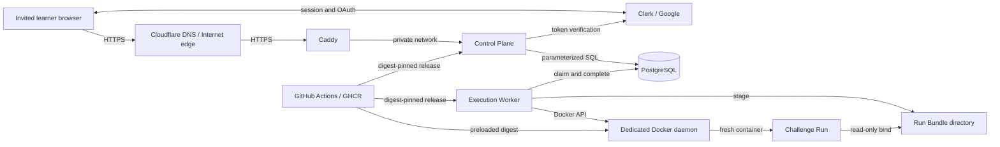

# MakeItGreen production threat model

**Status:** baseline for owner review

**Last reconciled with the codebase:** 2026-09-10

**Target deployment:** small, invite-only beta on one dedicated DigitalOcean
Droplet, following [`DEPLOY_DIGITALOCEAN.md`](DEPLOY_DIGITALOCEAN.md)

This document defines what MakeItGreen must protect before Hosted Mode receives
untrusted traffic. It separates controls already enforced by the application from
controls that only the deployment can provide. A green application test suite is
not evidence that the deployment gates below are satisfied.

## Executive decision

MakeItGreen is **not ready for untrusted public traffic**. It may open an invited
beta only after every `G-*` launch gate in this document has recorded passing
evidence and the owner has explicitly accepted the two beta residual risks:

1. An authorized learner can still copy content manually or coordinate across
   accounts. The product can make bulk extraction expensive and detectable, but
   cannot make content shown in a browser impossible to copy.
2. The proposed low-cost beta colocates the Execution Worker and its Docker daemon
   with the Control Plane and PostgreSQL. A container-runtime or kernel escape can
   therefore compromise the whole host. Small enrollment, one-at-a-time execution,
   a single-purpose patched host, backups, and monitoring reduce this risk; moving
   the worker to a separate host is the required next isolation step before opening
   registration beyond known invitees.

Clerk Invite-only mode and the signed `beta_access: true` claim are necessary, but
they are admission controls rather than a sandbox. An invited account must still be
treated as hostile when it submits source code.

## Scope and assumptions

### In scope

- The React/Monaco browser client and Clerk session handling.
- The public FastAPI Control Plane in Hosted Mode.
- Immutable challenge metadata, starter repositories, tests, and solutions.
- PostgreSQL Learner Challenge State, Run Jobs, rate limits, audits, product events,
  and worker release heartbeats.
- The non-HTTP Execution Worker, shared Run Bundle directory, Docker daemon, and
  disposable Python and Node Challenge Run containers.
- Caddy, Cloudflare DNS, the DigitalOcean host/firewall, backups, and log export.
- GitHub Actions, GHCR images, attestations, promotion, and rollback.
- Clerk, Google OAuth, operator accounts, secrets, and administrative actions.

### Out of scope

- Local Mode. It is a trusted personal workflow and must never receive untrusted
  traffic.
- Denial or compromise of Clerk, Google, GitHub, Cloudflare, DigitalOcean, or the
  operator's endpoint beyond the controls those providers expose. Their compromise
  remains a dependency risk.
- Preventing a legitimate learner from remembering, photographing, transcribing, or
  rewriting content that the product intentionally displays.
- Perfect grading against an adversarial candidate process. Infrastructure isolation
  is required for beta; stronger trusted-supervisor grading is a later integrity
  improvement.

### Deployment assumptions

- `makeitgreen.dev` is the only public application origin.
- `accounts.makeitgreen.dev` and `clerk.makeitgreen.dev` remain Clerk-managed.
- Only Caddy exposes ports 80 and 443. SSH is restricted to the administrator's
  current IP. FastAPI, PostgreSQL, the worker, and the Docker API have no public port.
- The Droplet is dedicated to MakeItGreen and does not host unrelated workloads.
- Worker concurrency, global active runs, and per-user active runs are all `1` for
  the initial beta.
- Challenge content and execution images are trusted release inputs. Learner
  workspace overlays and their runtime behavior are untrusted.

## System and trust boundaries

| Boundary | Less-trusted side | More-sensitive side | Required enforcement |
|---|---|---|---|
| TB-1 Internet edge | Anonymous network client | Caddy and application origin | TLS, edge request limits, DDoS controls, no direct backend port |
| TB-2 Browser/API | Browser and bearer token | Control Plane and learner data | Clerk signature/session validation, authorized-party allowlist, exact `beta_access` claim, request-size and rate limits |
| TB-3 Identity provider | OAuth/session response | Application authorization | Production Clerk keys, Google OAuth credentials, Invite-only mode, administrator-only beta grant, revocation procedure |
| TB-4 Control Plane/database | Public request-derived values | All durable tenant state | Parameterized queries, `user_id` from verified `sub`, least-privilege application role, backups and audit export |
| TB-5 Control Plane/worker | Enqueued job | Execution authority | PostgreSQL queue, fenced claims and leases, no Docker socket or CLI in Control Plane |
| TB-6 Worker/Docker | Worker process | Host-level container authority | Dedicated worker, restricted host access, exact images, runtime readiness, host patching; worker compromise is host compromise |
| TB-7 Run Bundle/container | Learner-controlled overlay | Host and trusted challenge inputs | Revalidation, read-only bind, private propagation, tmpfs copy, no network, non-root UID, read-only root, dropped capabilities, resource limits |
| TB-8 CI/runtime | Repository and build workflow | Deployable artifacts | Pinned actions/bases, scans, SBOMs, provenance, immutable digests, protected promotion and rollback |
| TB-9 Operator/control planes | Human administrator | DNS, identity, cloud, registry, secrets | MFA/passkeys, least privilege, recovery codes, credential rotation, auditable changes |

## Assets and security objectives

| ID | Asset | Confidentiality | Integrity | Availability |
|---|---|---:|---:|---:|
| A-1 | Challenge briefs, repositories, tests, and reference solutions | High — core product content | High | Medium |
| A-2 | Learner workspace files, run output/history, debriefs, and progress | High | High | Medium |
| A-3 | Clerk sessions, Google OAuth configuration, beta authorization | High | High | High |
| A-4 | Clerk, database, registry, SSH, backup, and log-pseudonym secrets | Critical | Critical | High |
| A-5 | PostgreSQL state, audit records, and release heartbeats | High | Critical | High |
| A-6 | Execution host, Docker daemon, and Run Bundle storage | Critical | Critical | High |
| A-7 | Release images, challenge content, SBOMs, and promotion records | Medium | Critical | High |
| A-8 | Service capacity and the operator's cloud spend | Low | Medium | High |

## Actors

- **Anonymous client:** has network access but no valid Clerk session.
- **Invited learner:** may read authorized content and submit arbitrary source code.
- **Malicious invited learner:** deliberately scrapes, exhausts capacity, tampers with
  grading, probes tenant boundaries, or attempts container escape.
- **Compromised learner account:** possesses a valid session without the owner's
  consent.
- **Distributed extractor:** coordinates multiple approved or compromised accounts to
  stay below per-user limits.
- **Supply-chain attacker:** attempts to alter source, dependencies, Actions, images,
  tags, or release records.
- **Compromised application component:** gains the privileges of the Control Plane,
  worker, database role, or log collector.
- **Operator error or compromise:** misconfigures Hosted Mode, exposes a port, leaks a
  secret, grants beta access incorrectly, or deploys the wrong release.

## Invariants enforced by the application

These claims are present in code and tests. The deployment must not bypass them.

1. `GREENLINE_MODE` is mandatory. Hosted Mode fails composition unless Clerk,
   PostgreSQL state, durable Run Jobs, abuse controls, trusted proxies, security
   logging, process role, and immutable release identity are configured.
2. Every Hosted `/api/*` request requires a verified Clerk session whose `azp` is in
   `CLERK_AUTHORIZED_PARTIES` and whose signed `beta_access` claim is exactly `true`.
3. Learner identity comes only from the verified Clerk `sub`; request bodies and URLs
   cannot choose a tenant ID.
4. The Hosted Control Plane uses a disabled execution adapter and contains neither the
   Docker CLI nor the Docker socket.
5. The Execution Worker has no HTTP listener or Clerk secret. It receives work through
   PostgreSQL and requires a current claim token plus a monotonically fenced Operation
   Lease to publish output or results.
6. Hosted learner state, coordination, request admission, content-access counters, and
   audit records use PostgreSQL and require the exact migration version.
7. Persisted workspace overlays are canonicalized and revalidated before a Run Bundle
   is created. Traversal, symlinks, protected tests/configuration, and unauthorized new
   paths are rejected.
8. Challenge Run images are preloaded and addressed by digest. The worker never pulls
   an execution image while serving a learner.
9. Each Challenge Run uses a fresh container with networking and IPC disabled, a
   read-only root, a numeric non-root user, all capabilities dropped, no privilege
   escalation, and bounded CPU, memory/swap, PIDs, file descriptors, tmpfs, output, and
   wall time.
10. Hosted catalog responses expose browsing summaries only. Detailed challenge
    content is metered, and solutions require that learner's solved or spoiled state.
11. Security logs pseudonymize Clerk subjects and exclude tokens, raw subjects,
    request bodies, learner paths, and database URLs.
12. Release readiness includes the exact source commit, at least one fresh matching
    worker, and the exact Python and Node execution-image references.

## Threat register

Risk is the expected beta risk **after current application controls but before missing
deployment gates**: Critical, High, Medium, or Low.

### Identity and authorization

| ID | Threat and impact | Existing control | Residual risk / required treatment | Risk |
|---|---|---|---|---:|
| T-ID-1 | Anonymous or uninvited access to the API | Clerk verification, Invite-only configuration, signed `beta_access` gate | Prove Production keys and authorized parties are used; test no-token, invalid-token, wrong-`azp`, and missing-beta requests against the deployed edge | Medium |
| T-ID-2 | Invite accepted by the wrong account or beta granted too broadly | Invitation email ownership and administrator-set public metadata | Document the grant/revoke checklist; verify the invited email before granting; review users weekly during beta | Medium |
| T-ID-3 | Stolen session or OAuth account permits authorized access | Clerk/Google session controls and revocation | Require MFA/passkeys for all operator accounts; define learner-session revocation and incident response; avoid long-lived credentials in browsers | Medium |
| T-ID-4 | Forged or stale `beta_access` is trusted | Claim is inside Clerk's verified session token and compared as boolean `true` | On revocation, end the user's Clerk sessions rather than waiting only for claim refresh; verify this drill | Low |
| T-ID-5 | OAuth or DNS misconfiguration redirects users to an attacker | Clerk-managed subdomains and configured Google callback | Lock down Cloudflare, Clerk, and Google accounts with MFA; inventory exact origins/callbacks; alert on DNS changes | Medium |

### Tenant data and application input

| ID | Threat and impact | Existing control | Residual risk / required treatment | Risk |
|---|---|---|---|---:|
| T-DATA-1 | IDOR exposes or changes another learner's workspace, jobs, history, or debrief | Verified `sub` supplies `user_id`; state and job queries are tenant-scoped; behavioral tests cover isolation | Application database role can read all tenants and PostgreSQL RLS is not implemented. Keep the DB private, use a least-privilege role, retain cross-tenant tests for every new endpoint, and evaluate RLS before multi-tenant scale | Medium |
| T-DATA-2 | Path traversal, symlink, or protected-file overwrite changes trusted tests or host files | Canonical path policy, intrinsic read-only files, creatable allowlist, overlay revalidation, read-only Run Bundle | Keep validation tests in CI; treat any new file API or archive import as a new threat-model review trigger | Low |
| T-DATA-3 | SQL injection corrupts or discloses PostgreSQL | Current adapters use parameterized queries and bounded enums/actions | Maintain parameterization; prohibit request-derived SQL identifiers; DB role must have no DDL or role-management privileges | Low |
| T-DATA-4 | Oversized bodies, outputs, free text, or histories exhaust memory/storage | 256 KiB request default, bounded fields, 20k output, ten run checkpoints, retention/pruning | Add disk/DB growth alerts and quotas; load-test chunked bodies and repeated allowed-size writes | Medium |
| T-DATA-5 | Learners put secrets or personal data in workspaces/debriefs; backups or support access expose it | No source or free text in Product Events/security logs | Publish a beta privacy notice, restrict backup/log access, define deletion/retention, and never use learner content for support without consent | Medium |
| T-DATA-6 | Browser-rendered learner or challenge text executes script and steals a token | React escapes text; Markdown is rendered without an intentional raw-HTML path | Add deployment CSP and regression tests for hostile Markdown/file names; review any future HTML/preview plugin as a security-sensitive change | Medium |

### Untrusted code execution

| ID | Threat and impact | Existing control | Residual risk / required treatment | Risk |
|---|---|---|---|---:|
| T-EXEC-1 | Learner code reads service secrets or mutates the Control Plane | Separate non-HTTP worker; fresh constrained container; no network; read-only bundle/root; no app secrets passed to run | Verify the container environment and mounts in a real deployment smoke test; execution images must contain no deployment credentials | Medium |
| T-EXEC-2 | Container or kernel escape compromises the Docker host | Non-root process, dropped capabilities, `no-new-privileges`, resource limits, immutable images | Docker shares the host kernel. Patch host/runtime promptly, keep default seccomp active, run no unrelated workloads, alert on daemon/container anomalies, and explicitly accept the one-host beta risk | High |
| T-EXEC-3 | Worker compromise uses the Docker socket for host-root control | Docker authority exists only in the worker; Control Plane has none | Treat worker compromise as host compromise. Give worker no Clerk secret, use the narrow DB role possible today, restrict shell access, and move it to a separate host before unknown-user registration | High |
| T-EXEC-4 | Fork bomb, memory bomb, output flood, infinite loop, or run storm denies service or raises cost | Per-container CPU/memory/PID/fd/tmpfs/output/time limits; global/per-user capacity; run rate limits; concurrency one for beta | Monitor OOMs, queue age, disk, CPU, and spend; test orphan cleanup and reboot recovery; edge-limit requests before Python | Medium |
| T-EXEC-5 | Learner code exfiltrates data over the network | `--network none`; no credentials in the run; bundle contains only one learner/challenge snapshot | DNS/network absence must be verified from both execution images. Output remains an intentional channel back to the same learner | Low |
| T-EXEC-6 | Candidate tampers with the test process or its report to obtain a false green | Tests/config are read-only in the submitted overlay and scoring is normalized | Candidate code and tests share a container/process trust domain. Treat scores as practice feedback, not certification; design a trusted supervisor before scores gain external value | Medium |
| T-EXEC-7 | Orphaned or stale worker publishes a late result over newer state | Durable claims, heartbeats, fenced leases, atomic completion | Exercise worker-kill, lease-expiry, duplicate-worker, and host-reboot drills in staging | Low |

### Product-content protection

| ID | Threat and impact | Existing control | Residual risk / required treatment | Risk |
|---|---|---|---|---:|
| T-CONTENT-1 | Anonymous scraper downloads the challenge bank | Entire Hosted API requires Clerk and `beta_access`; catalog contains summaries only | Prove the deployed edge cannot reach an unauthenticated alternate port or Local Mode process | Low |
| T-CONTENT-2 | Authorized learner automates sequential content extraction | 120 content reads/minute, 20 distinct challenges/hour, five solutions/hour, durable cross-replica counters, security event on bulk access | Limits slow extraction; they do not prevent patient scraping. Alert and revoke accounts that show systematic extraction | Medium |
| T-CONTENT-3 | Learner retrieves all solutions | Per-learner solved/spoiled gate plus solution rate limit | A learner may intentionally spoil and copy up to the limit. Preserve the learning tradeoff; consider canary markers only if they do not harm challenge quality | Medium |
| T-CONTENT-4 | Multiple accounts collude to bypass per-user limits | Invite-only enrollment and manual beta grant | Keep the invite list small, verify identities, prohibit account sharing in beta terms, review correlated security signals without collecting invasive learner content | Medium |
| T-CONTENT-5 | Content leaks from repository, image registry, CI artifact, backup, or operator machine | Private access can be applied outside the app; immutable releases aid attribution | Confirm repository/package visibility matches the business decision; limit collaborator/package access; ensure backups and image layers do not unintentionally publish solutions | High until verified |

### Network, availability, and operations

| ID | Threat and impact | Existing control | Residual risk / required treatment | Risk |
|---|---|---|---|---:|
| T-NET-1 | Direct access to FastAPI bypasses Caddy policy or spoofs forwarding headers | Hosted launcher requires explicit trusted proxy CIDRs and rejects wildcard trust | Cloud Firewall and Compose must publish only 80/443; verify 8000/5432/Docker are unreachable externally and from an untrusted container | High until deployed |
| T-NET-2 | DDoS or request flood exhausts the single Droplet before application limits run | Authenticated application limits and run capacity | Configure Cloudflare/edge limits, connection/body limits, timeouts, and DigitalOcean alerts; rehearse temporary deny/block response | High until deployed |
| T-NET-3 | PostgreSQL loss or corruption destroys learner state and audit evidence | Durable database and explicit migrations | Create encrypted off-host logical backups and prove restoration into a disposable database before invites | High until proven |
| T-OPS-1 | Secret appears in source, logs, shell history, screenshots, or local files | Secret-file support, ignored `.env*`, redacted application errors | Rotate on any exposure; scan Git history and images; mount production secrets read-only; document owners and rotation intervals | High until proven |
| T-OPS-2 | Security events are emitted but never collected or acted upon | Bounded one-line JSON events and durable mutation audits | Configure an external collector, retention, alert thresholds, on-call destination, and a test event before beta | High until deployed |
| T-OPS-3 | Compromised backup or log sink leaks learner data | Pseudonymized security subjects and bounded fields | Encrypt backups in transit/at rest, restrict credentials, test access, and keep the HMAC key separate from exported logs | Medium |
| T-OPS-4 | Health endpoint leaks topology or gives false rollout confidence | Separate live/ready/release contracts and bounded release data | Expose only necessary health routes; promotion must require the exact commit and execution digests, not generic HTTP 200 | Low |

### Supply chain and release integrity

| ID | Threat and impact | Existing control | Residual risk / required treatment | Risk |
|---|---|---|---|---:|
| T-SUPPLY-1 | Mutable or substituted image executes unreviewed code | Digest-pinned bases/execution images, no runtime pull, archive/digest verification, immutable commit tags | Deployment must consume release-manifest digests, verify attestations where available, and never deploy `latest`, `staging`, or `production` as the recorded immutable identity | Medium |
| T-SUPPLY-2 | Dependency or base-image vulnerability compromises a component | CI scans fixable high/critical findings, SBOMs, minimal runtime images, package managers removed | Define patch SLA and expiry-owner process for scanner exceptions; alert when the current production digest is superseded for security | Medium |
| T-SUPPLY-3 | Unauthorized promotion or partial rollout breaks release consistency | Protected GitHub Environments, serialized four-image promotion, exact release readiness, automatic tag restoration | Configure required reviewers/no self-review and bootstrap a complete rollback set before first promotion | High until configured |
| T-SUPPLY-4 | GitHub, GHCR, cloud deploy credential, or maintainer account is compromised | Short-lived Actions credentials and pinned Actions | Require MFA/passkeys, least privilege, branch protection, secret scanning, and periodic access review across every control plane | Medium |

## Required launch gates and evidence

Every row must have an owner, a date, and a durable evidence link or artifact. A verbal
confirmation is not sufficient.

### Evidence snapshot on 2026-09-10

- The GitHub repository was verified as **private** through the GitHub API.
- GHCR package visibility could not be verified with the current token because it lacks
  `read:packages`; treat package privacy as unproven until G-9 records it.
- `backend/.env.local` is ignored and not tracked, but it contains a development Clerk
  secret. That secret must be rotated after its accidental exposure during this review.
- The repository contains no production Compose manifest or Caddyfile yet, so network,
  header, port, and edge-control claims remain unproven.
- PostgreSQL schema version 7 and migrations `001` through `007` are the current
  application contract.
- The Clerk/Google configuration was exercised manually through the hosted Account
  Portal, but the deployed MakeItGreen origin does not exist yet. G-1 still requires
  end-to-end tests through that origin.

| Gate | Requirement | Passing evidence | Status |
|---|---|---|---|
| G-1 Identity | Production Clerk uses Invite-only, Google OAuth, exact authorized origins, signed boolean beta claim, and approved users only | Screenshots/export of settings; deployed 401/403/200 tests; grant-and-revoke drill | Partially complete; deployment test pending |
| G-2 Secrets | Production secrets are mounted/injected, absent from Git/images/logs, independently rotatable, and operator accounts use MFA | Secret scan; mount/permission check; rotation record for Clerk, DB, HMAC, GHCR/deploy credentials | Open; rotate exposed development Clerk secret |
| G-3 Network | Only Caddy 80/443 is public; SSH is IP-restricted; backend, DB, Docker, and worker are unreachable | External port scan plus host/Compose/firewall configuration capture | Open |
| G-4 Edge | TLS, HSTS, CSP, MIME/referrer/frame policies, body/connection limits, and edge rate/DDoS controls are active | Header scan, TLS scan, oversized/chunked request test, rate-limit test | Open |
| G-5 Database | Migrations through schema version 7 use a DDL owner; runtime role has no DDL; PostgreSQL is private | Role/grant query output, schema-version output, external connectivity test | Open |
| G-6 Execution | Both digest-pinned runtimes pass isolation, no-network, resource-limit, timeout, and orphan-cleanup checks on the real host | Staging smoke artifact for Python and Node plus adversarial resource/network tests | Open |
| G-7 Recovery | Encrypted off-host PostgreSQL backup and whole-host backup exist; restore succeeds in a disposable environment | Timestamped restore drill with row counts and application readiness | Open |
| G-8 Detection | JSON security logs leave the host; alerts cover auth denials, scraping, rate/capacity exhaustion, readiness, worker loss, OOM, disk, queue, and backup failure | Test events received at the alert destination and acknowledged | Open |
| G-9 Release | Four exact scanned/attested image digests are deployed; protected promotion and complete rollback work | Release manifest, promotion record, `/health/release`, rollback drill | Open |
| G-10 Beta operations | Named testers, support/incident contact, privacy/retention notice, account-revocation procedure, spend alert, and one-week capacity review are defined | Owner-approved beta checklist and incident tabletop record | Open |

## Minimum adversarial staging tests

Run these through the public HTTPS origin, not directly against a developer process:

1. No token, malformed token, wrong authorized party, and valid token without
   `beta_access` return 401/403 and never create learner state.
2. Revoking `beta_access` and ending sessions blocks the next request.
3. User A cannot read, mutate, restore, reset, spoil, debrief, or poll User B's data or
   Run Job ID.
4. Encoded traversal, symlink overlays, protected test/config writes, and unauthorized
   new paths fail before a Run Bundle is staged.
5. Python and Node submissions attempt outbound TCP/DNS, fork/process floods, memory
   exhaustion, disk/tmpfs exhaustion, output flooding, and timeout descendants.
6. Killing a worker mid-run, starting a replacement, and later reviving the old worker
   cannot publish two results or overwrite newer state.
7. Crossing content, distinct-challenge, solution, mutation, run, and capacity limits
   returns 429, persists bounded audit evidence, and produces the expected alert.
8. Public scans cannot reach ports 8000 or 5432, the Docker API, the worker, or a Run
   Bundle path. A Challenge Run container cannot reach PostgreSQL, Caddy, metadata
   services, or the Internet.
9. A database outage makes readiness and request admission fail closed; recovery does
   not lose tenant boundaries or operation fences.
10. Restore the latest logical backup into a disposable database, start matching API
    and worker digests, and complete one Python and one Node practice loop.
11. Promote a known release, verify exact-version readiness, then roll back all four
    components and verify the recorded digest set.
12. Render hostile Markdown, file names, test messages, and output; verify they remain
    text and that the deployed CSP blocks unexpected script execution.

## Incident priorities

1. **Contain execution:** stop the worker and block new Run Jobs if container escape,
   Docker abuse, or host compromise is suspected.
2. **Contain identity:** revoke the learner's beta metadata and Clerk sessions for
   account abuse; rotate Clerk/Google credentials if provider configuration may be
   exposed.
3. **Preserve evidence:** snapshot relevant audit rows, external security logs, release
   digests, host events, and Cloudflare logs without copying learner source into general
   logs.
4. **Rotate by boundary:** assume a host compromise exposes the worker database/HMAC
   secrets and any host registry credential. Assume Control Plane compromise exposes
   Clerk, database, and HMAC secrets. Rotate affected credentials independently.
5. **Recover immutably:** redeploy a known attested digest set onto a clean host; do not
   repair a suspected-compromised host in place.
6. **Notify and learn:** notify affected beta users when their account or content may
   have been exposed, record the root cause, and add a regression or deployment check.

## Accepted limitations and review triggers

The owner must review this model again before any of the following:

- opening self-service registration or removing either invite/beta gate;
- increasing execution concurrency or adding more workers;
- placing unrelated workloads on the execution host;
- adding a new language, runtime, dependency-install path, file upload/archive import,
  preview renderer, or networked challenge;
- moving PostgreSQL, the worker, or Run Bundle storage across hosts/providers;
- making scores externally meaningful or adding competitive rankings;
- adding organization/team sharing, administrative APIs, billing, or AI features;
- changing authentication providers, custom claims, session duration, domains, or
  frontend token storage;
- exposing challenge or solution content through a new endpoint, cache, artifact, or
  analytics system;
- a material security incident, dependency compromise, or container-runtime advisory.

## Owner review record

| Decision | Owner | Date | Notes |
|---|---|---|---|
| Accept manual-copy/content-collusion limitation for invited beta | Pending | Pending | Required before G-10 closes |
| Accept single-host Docker/kernel risk for invited beta | Pending | Pending | Required before G-6/G-10 close |
| Approve beta launch after gates G-1 through G-10 pass | Pending | Pending | No public traffic before approval |
